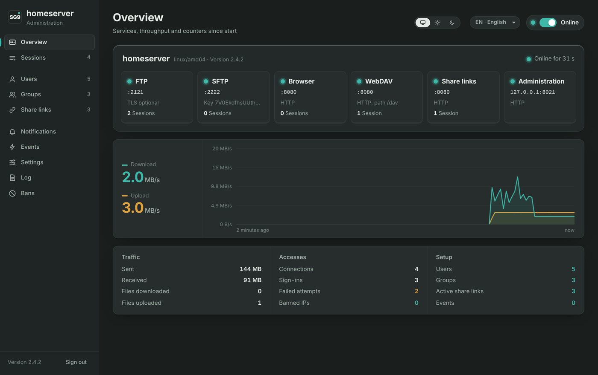
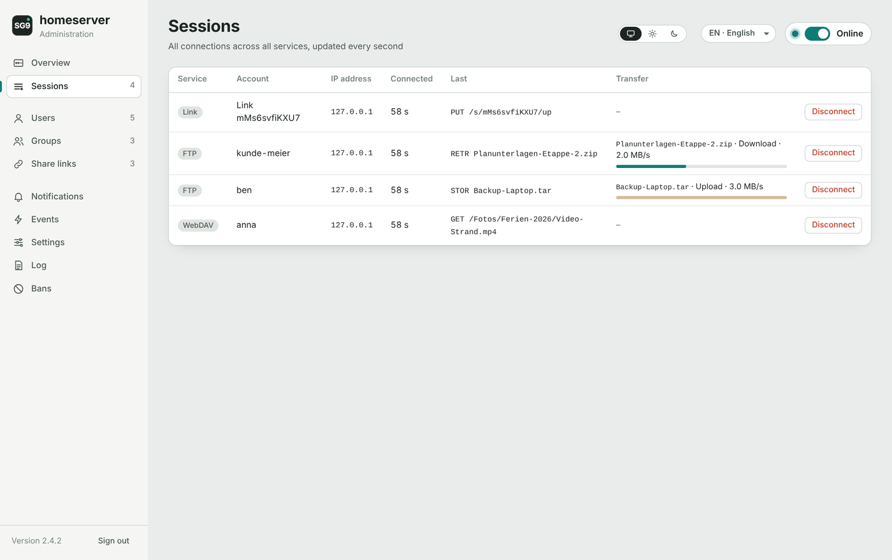
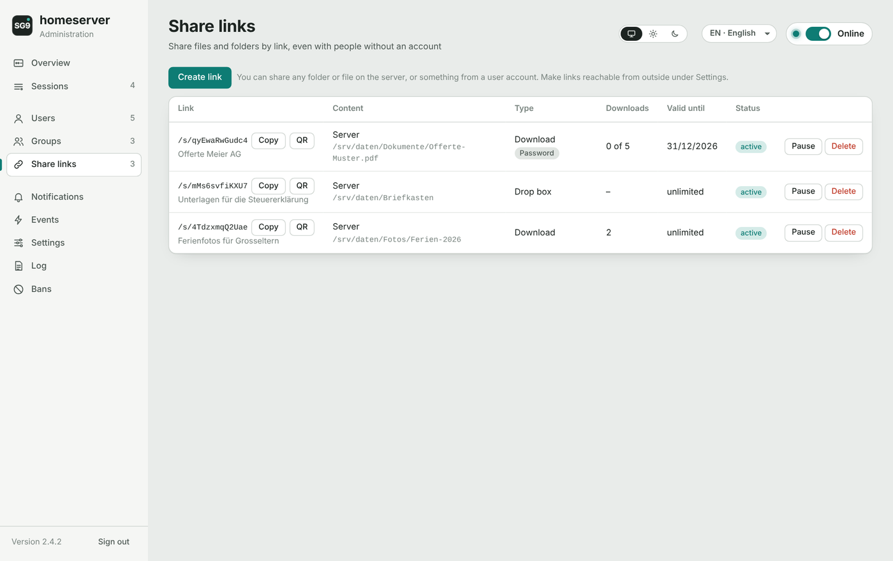
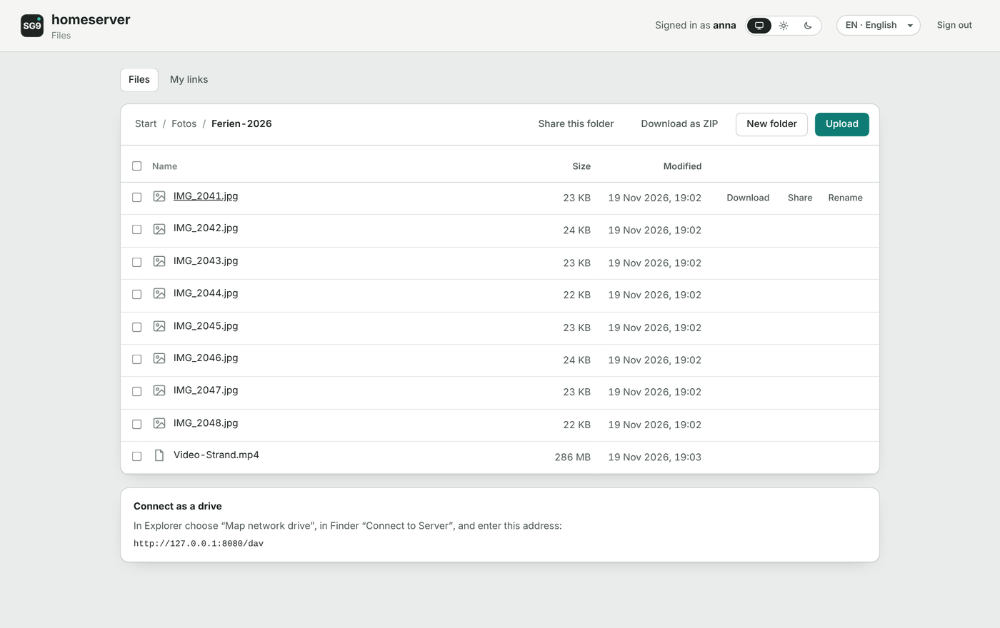
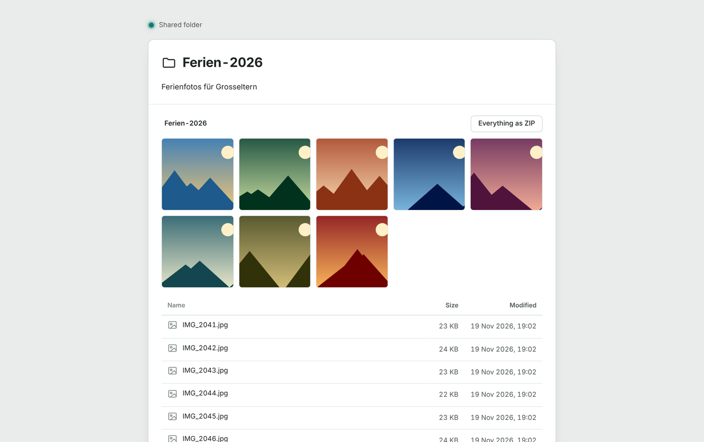
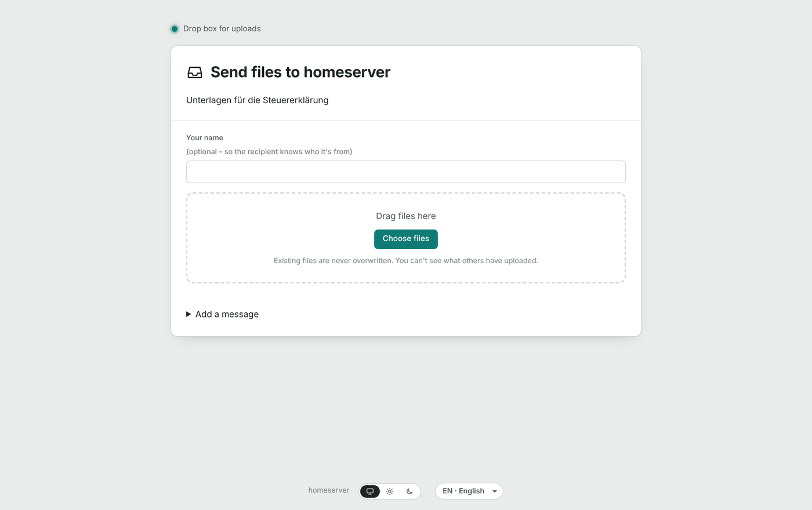

# SG9 Server

*[English version](README.en.md)*

Ein Datei-Server im Geist des alten G6 FTP Server: Benutzer, Gruppen, virtuelle Ordner,
Speed-Limits, Ratio und eine Verwaltung im Browser. Dazu die modernen Wege, auf Dateien
zuzugreifen: SFTP, WebDAV als Netzlaufwerk, ein Dateimanager im Browser und Freigabe-Links.

Eine einzige Datei pro Betriebssystem, keine Installation, keine Abhängigkeiten.
Läuft auf **Windows**, **Linux** (auch Raspberry Pi) und **macOS** (Intel und Apple Silicon).

**Sprachen:** Die Oberfläche gibt es auf Deutsch, Englisch, Französisch und Italienisch. Umschalten
geht oben neben dem Hell/Dunkel-Schalter (**DE · EN · FR · IT**). Freigabe-Seiten erscheinen
automatisch in der Sprache des Besuchers.



| Sitzungen live | Freigabe-Links |
|---|---|
|  |  |
| **Dateien im Browser** | **Geteilter Ordner mit Galerie** |
|  |  |
| **Briefkasten** | **Auf dem Handy** |
|  |  |

## Schnellstart

Installation als Dienst, Aktualisieren und Deinstallieren für Windows, Linux, macOS, Docker und Unraid:
**[INSTALL.md](INSTALL.md)**

```bash
./sg9          # Linux / macOS
sg9.exe        # Windows
```

Beim ersten Start legt SG9 neben der Programmdatei den Ordner `sg9-data/` an.

1. Verwaltung öffnen: <http://localhost:8021>
2. Beim ersten Mal dein eigenes Passwort festlegen
3. Unter **Benutzer** einen Benutzer anlegen
4. Verbinden, wie es passt:

| Weg | Adresse | Programm |
|---|---|---|
| FTP / FTPS | `server:2121` | FileZilla, WinSCP, Cyberduck |
| SFTP | `server:2222` | FileZilla, WinSCP, `sftp`, Cyberduck |
| Browser | `http://server:8080` | jeder Browser |
| Netzlaufwerk (WebDAV) | `http://server:8080/dav` | Windows Explorer, macOS Finder, Linux-Dateimanager |
| Freigabe-Link | `http://server:8080/s/…` | jeder Browser, ohne Konto |

## Ports

Jeder Dienst hat seinen eigenen Port, einstellbar unter **Einstellungen → Dienste und Ports**.
Änderungen gelten sofort, ohne Neustart, auch für die Verwaltung selbst (die Seite leitet dann
auf den neuen Port weiter). Jeder Dienst lässt sich einzeln ein- und ausschalten und auf eine
bestimmte IP-Adresse beschränken.

| Dienst | Standard | üblich |
|---|---|---|
| FTP | 2121 | 21 |
| FTPS implizit | aus | 990 |
| SFTP | 2222 | 22 |
| Browser | 8080 | 443 |
| WebDAV | wie Browser | 443 |
| Freigabe-Links | wie Browser | 443 |
| Verwaltung | 127.0.0.1:8021 | – |
| FTP-Passivbereich | 50000–50100 | – |

- Browser, WebDAV und Freigabe-Links dürfen sich einen Port teilen oder jeweils einen eigenen haben,
  z. B. nur die Links nach aussen freigeben und den Rest im eigenen Netz lassen.
- SG9 prüft vor dem Speichern, ob ein Port doppelt vergeben, im FTP-Passivbereich oder schon von
  einem anderen Programm belegt ist, und speichert dann nicht.
- Die Standardports liegen über 1024, damit SG9 ohne Administrator- bzw. root-Rechte läuft.
  Für 21, 22 oder 443 unter Linux die Vorlage `deploy/sg9.service` verwenden.

## Was SG9 kann

**Wie bei G6**
- Benutzer und Gruppen, Benutzer erben von ihrer Gruppe; `%u` im Pfad = Benutzername
- Virtuelle Ordner: beliebige Ordner oder Netzlaufwerke (`D:\Fotos`, `\\NAS\Freigabe`) unter eigenem Pfad freigeben
- Rechte pro Ordner: Auflisten, Lesen, Schreiben, Anhängen, Löschen, Umbenennen, Ordner anlegen und löschen
- Speed-Limits pro Benutzer, pro Gruppe und für den ganzen Server
- Ratio (Upload/Download-Verhältnis) mit Startguthaben, `SITE RATIO` im FTP
- Speicherplatz-Kontingent, maximale Verbindungen gesamt, pro IP und pro Benutzer
- Ausgeblendete Dateien (`Thumbs.db`, `*.tmp`) und gesperrte Dateitypen beim Upload (`*.exe`)
- Begrüssung pro Benutzer oder Gruppe, `.message`-Dateien beim Ordnerwechsel
- IP-Filter global und pro Benutzer (IP, CIDR, `192.168.1.*`), Sperre nach Fehlversuchen
- Ablaufdatum für Konten, anonymer Zugang über den Benutzer `anonymous`
- Online/Offline-Schalter, Live-Sitzungen mit Fortschritt und „Trennen“, Live-Protokoll

**Neu**
- **SFTP** mit Passwort oder SSH-Schlüssel (Shell-Zugang gibt es bewusst nicht)
- **WebDAV**: SG9 als Netzlaufwerk im Explorer oder Finder einbinden
- **Dateien im Browser**: hochladen per Drag & Drop, Ordner als ZIP, Bildvorschau
- **Freigabe-Links** für jeden Ordner und jede Datei auf dem Server oder aus einem Benutzerkonto, optional mit Passwort, Ablaufdatum und Download-Limit
- **Let's Encrypt** eingebaut: echtes HTTPS-Zertifikat für Links von ausserhalb, ohne Reverse Proxy
- **Briefkasten-Links**: andere laden Dateien zu dir hoch, ohne zu sehen, was schon da ist
- **Briefkasten mit Absender**: Name und Nachricht angeben, die Dateien landen in einem Unterordner pro Absender
- **Vorschau und Galerie**: Bilder als Galerie mit Blättern, PDFs, Videos und Musik direkt im Browser (HTML und SVG aus Sicherheitsgründen nie)
- **QR-Code** zu jedem Link, zum schnellen Weitergeben aufs Handy
- **Länderfilter**: Links (oder alle Dienste) nur aus bestimmten Ländern erreichbar, mit einer kostenlosen GeoIP-Datenbank
- **Ereignisse**: bei Upload, Download, Anmeldung, Fehlversuch usw. ein Skript starten oder einen Webhook aufrufen
- **Benachrichtigungen** per ntfy (Push aufs Handy), E-Mail oder Home Assistant: Briefkasten, Downloads, Sperren, Fehler
- **Zwei-Faktor-Anmeldung** für die Verwaltung (Authenticator-App) mit Wiederherstellungscodes
- **Sicherung und Umzug**: Einstellungen als ZIP herunterladen und wiederherstellen, dazu eine tägliche automatische Sicherung
- **Prüfprotokoll**: wer wann was in der Verwaltung geändert hat
- **Update-Hinweis**: einmal täglich ein Blick auf GitHub, ob es eine neue Version gibt (abschaltbar, lädt nichts herunter)
- **Sprachen**: Deutsch, English, Français, Italiano; Freigabe-Seiten folgen automatisch der Sprache des Besuchers
- Verwaltung in Hell, Dunkel oder nach Systemeinstellung, auch auf dem Handy bedienbar

Alle Dienste nutzen dieselben Benutzer, Rechte, Limits und Kontingente. Pro Benutzer lässt
sich festlegen, welche Dienste er verwenden darf.

## Ereignisse

Befehle bekommen Umgebungsvariablen, Webhooks dieselben Angaben als JSON per POST:
`SG9_EVENT`, `SG9_USER`, `SG9_IP`, `SG9_PROTOCOL`, `SG9_PATH`, `SG9_REAL_PATH`, `SG9_BYTES`, `SG9_EXTRA`.

```bat
:: Windows: jeden Upload zusätzlich sichern
copy "%SG9_REAL_PATH%" "D:\Backup\"
```
```bash
# Linux/macOS: Uploads protokollieren
echo "$(date) $SG9_USER $SG9_PATH" >> /var/log/sg9-uploads.log
```

## Netzlaufwerk einbinden

- **Windows:** Explorer → Dieser PC → „Netzlaufwerk verbinden“ → `https://server:8080/dav`.
  Windows verlangt dafür HTTPS. Unter **Einstellungen → Dienste und Ports** „HTTPS für Browser,
  WebDAV und Links“ einschalten. Mit dem selbst signierten Zertifikat muss es vorher einmal als vertrauenswürdig
  importiert werden, mit einem echten Zertifikat (z. B. Let's Encrypt) klappt es direkt.
- **macOS:** Finder → Gehe zu → „Mit Server verbinden“ → `http://server:8080/dav`
- **Linux:** im Dateimanager `davs://server:8080/dav` bzw. `dav://…`

## Freigabe-Links von ausserhalb erreichbar machen

1. **Domain auf deine Adresse zeigen lassen**, z. B. per DynDNS im Router (OPNsense: Plugin `os-ddclient`).
2. **Im Router Port 443 weiterleiten** an den SG9-Rechner, auf den Port der Freigabe-Links. Am besten geben
   die Links dafür einen eigenen Port (Einstellungen → Dienste und Ports), dann bleibt alles andere im eigenen Netz.
   Es braucht nur diesen einen Port, Port 80 nicht.
3. **Einstellungen → Links von ausserhalb erreichbar machen:** Let's Encrypt einschalten, Domain eintragen,
   speichern, „Zertifikat holen“. SG9 erneuert das Zertifikat danach selbst. Die Links tragen automatisch
   `https://deine-domain`.

Ohne öffentliche IPv4-Adresse (CGNAT) oder ohne eigene Domain geht es mit einem Tunnel, z. B.
`tailscale funnel <links-port>`. Dessen Adresse trägst du dann als „Öffentliche Adresse für Links“ ein,
Let's Encrypt bleibt aus.

Läuft SG9 als Dienst (Benutzer `sg9`), darf es nur Ordner lesen, für die dieser Benutzer Rechte hat.
Ordner in deinem Home-Verzeichnis gehören dazu meist nicht. Entweder die Dateien unter `/srv` ablegen oder
dem Benutzer `sg9` Leserechte geben, z. B. mit `sudo setfacl -R -m u:sg9:rX /pfad/zum/ordner`.

## Zugriff übers Internet

1. Im Router die Ports der Dienste weiterleiten, die von aussen erreichbar sein sollen (für FTP auch den Passivbereich)
2. Für FTP unter **Einstellungen → FTP hinter einem Router** die öffentliche IP oder einen DynDNS-Namen eintragen
3. Für Freigabe-Links unter **Einstellungen → Freigabe-Links und WebDAV** die öffentliche Adresse eintragen, z. B. `https://dateien.example.ch`
4. Verschlüsselung einschalten: FTP auf „Erzwungen“, Web-Zugang mit HTTPS. SFTP ist immer verschlüsselt.

## Docker und Unraid

Das Image ist sehr klein (rund 14 MB, ohne Betriebssystem darin) und läuft als Benutzer 99:100,
wie unter Unraid üblich.

```bash
docker pull ghcr.io/hoax85/sg9:latest   # fertiges Image (amd64, arm64, armv7)
docker build -t sg9 .                          # oder selbst bauen
docker compose up -d                           # mit der mitgelieferten docker-compose.yml
```

- **Netzwerkmodus host** ist empfohlen: Dann funktioniert FTP im Passivmodus ohne weitere Einstellungen,
  und jeder Port, den du in SG9 einstellst, ist sofort erreichbar.
- **`/data`** enthält Einstellungen, Benutzer, Links und Schlüssel, **`/shares`** die Ordner, die SG9 teilen darf.
  Beim Erstellen eines Links beginnt die Auswahl direkt in `/shares`.
- **`SG9_ADMIN_LISTEN`** (Standard `:8021`) macht die Verwaltung beim ersten Start von aussen erreichbar.
  Danach gilt, was in SG9 eingestellt ist.
- Der Container hat einen eingebauten Gesundheitscheck (`sg9 -healthcheck`).

**Unraid:** `deploy/unraid/sg9.xml` nach `/boot/config/plugins/dockerMan/templates-user/my-SG9.xml`
kopieren, dann unter Docker → „Container hinzufügen“ die Vorlage „SG9“ wählen. In der Vorlage
`Repository` auf dein Image setzen, z. B. `ghcr.io/hoax85/sg9:latest`.

## Als Dienst einrichten

Für jedes System gibt es ein Skript, das installiert, aktualisiert und wieder entfernt.
Alle Schritte stehen in **[INSTALL.md](INSTALL.md)**.

- **Linux:** `sudo ./install-linux.sh` (systemd, Benutzer `sg9`, nach `/opt/sg9`), entfernen mit `--uninstall`
- **macOS:** `sudo ./install-macos.sh` (launchd, nach `/usr/local/sg9`), entfernen mit `--uninstall`
- **Windows:** `install-windows.ps1` kopiert SG9 nach `C:\Program Files\SG9`, richtet es als echten
  Windows-Dienst ein (sichtbar in `services.msc`, startet mit Windows, auch ohne Anmeldung, startet nach
  Absturz neu) und gibt das Programm in der Firewall frei, egal welche Ports eingestellt sind.
  Ohne Skript geht es auch direkt: `sg9.exe -install-service` in einer Administrator-PowerShell.

## Anmeldung an der Verwaltung

- **Beim ersten Öffnen** legst du Benutzername und Passwort selbst fest. Das geht nur am Rechner,
  auf dem SG9 läuft, oder von einem Gerät im eigenen Netz (praktisch für einen Raspberry Pi ohne Bildschirm).
- **Angemeldet bleiben:** Eine Anmeldung gilt 30 Tage pro Gerät und übersteht auch einen Neustart von SG9.
  Jede Nutzung verlängert sie.
- **Auf dem eigenen Rechner ohne Passwort:** bei der Einrichtung vorgeschlagen, später unter
  **Einstellungen → Allgemein** abschaltbar. Gilt nur für Aufrufe direkt am Rechner (localhost),
  von anderen Geräten braucht es immer das Passwort. Abschalten, wenn mehrere Leute den Rechner benutzen.
- **Passwort ändern** meldet alle anderen Geräte ab.
- **Zwei-Faktor:** unter **Einstellungen → Zwei-Faktor** mit einer Authenticator-App (Aegis, Bitwarden,
  2FAS, Google Authenticator) einschalten. Dazu gibt es zehn Wiederherstellungscodes für den Fall, dass das Handy weg ist.
- **Passwort vergessen:** `sg9 -reset-admin` ausführen, danach legst du beim nächsten Öffnen ein neues fest.
  Das schaltet auch die Zwei-Faktor-Anmeldung aus.

## Kommandozeile

```
sg9 -data <ordner>                   anderer Datenordner (Standard: sg9-data neben der Programmdatei)
sg9 -reset-admin                     Admin-Passwort löschen, beim nächsten Öffnen neu festlegen
sg9 -set-admin-password <passwort>   Admin-Passwort direkt setzen
sg9 -add-user name:passwort          Benutzer anlegen (Gruppe "Standard")
sg9 -quiet                           keine Log-Ausgabe auf der Konsole
sg9 -install-service                 als Windows-Dienst einrichten (Administrator)
sg9 -uninstall-service               Windows-Dienst entfernen, Daten bleiben
sg9 -healthcheck                     prüft, ob SG9 antwortet (für Docker)
sg9 -version
```

## Dateien in `sg9-data/`

| Datei | Inhalt |
|---|---|
| `sg9.json` | gesamte Konfiguration inkl. Freigabe-Links und Ereignisse |
| `sg9-admin-sessions.json` | Anmeldungen an der Verwaltung (nur Prüfsummen, keine Passwörter) |
| `sg9-userstats.json` | Übertragungszähler pro Benutzer (für Ratio und Statistik) |
| `sg9.log` | Protokoll |
| `sg9-cert.pem`, `sg9-key.pem` | selbst signiertes TLS-Zertifikat (FTPS, HTTPS) |
| `sg9-hostkey` | SSH-Schlüssel des Servers (SFTP) – beim Umzug mitnehmen, sonst warnen die Clients |
| `sg9-secret` | geheimer Schlüssel für Link-Passwörter |
| `sg9-audit.log` | Prüfprotokoll: Änderungen in der Verwaltung |
| `backups/` | tägliche automatische Sicherungen (die letzten 7) |
| `letsencrypt/` | Zertifikate von Let's Encrypt |
| `ftproot/<benutzer>/` | Home-Ordner der Gruppe „Standard“ |

Eine Konfiguration von SG9 1.x wird beim ersten Start übernommen und um die neuen Dienste ergänzt.

## Selbst bauen

Go 1.24 oder neuer. Alle Abhängigkeiten liegen im Ordner `vendor/`, es braucht also kein Internet:

```bash
./build.sh          # Linux / macOS → dist/
./package.sh        # Downloads für Windows, Linux, macOS → packages/
.\build.ps1         # Windows       → dist\
go build -o sg9 .   # nur für das aktuelle System
go test ./...       # Tests, inklusive Ende-zu-Ende-Test aller Dienste
```

Mit `SG9_REPO=name/sg9 ./build.sh` kennt das Programm sein GitHub-Projekt und zeigt neue Versionen an.

**Veröffentlichen auf GitHub:** Ein Tag wie `v2.4.0` pushen. Die Aktion in `.github/workflows/release.yml`
testet, baut alle Plattformen, legt ein Release mit den Downloads an und schiebt das Docker-Image
nach `ghcr.io`. Bei jedem Push laufen die Tests unter Linux, Windows und macOS.

Verwendete Bibliotheken: `golang.org/x/crypto/ssh` (SSH), `github.com/pkg/sftp` (SFTP),
`golang.org/x/net/webdav` (WebDAV), `golang.org/x/crypto/acme/autocert` (Let's Encrypt),
`rsc.io/qr` (QR-Codes), `github.com/oschwald/maxminddb-golang` (Länderfilter). Die `replace`-Zeilen in `go.mod` holen die offiziellen
golang.org/x-Pakete über ihre GitHub-Spiegel. Wer normalen Zugriff auf proxy.golang.org hat,
kann sie entfernen und `go mod tidy` ausführen.

## Bewusst nicht enthalten

- **SMB (Windows-Dateifreigabe):** Ein eigener SMB-Server wäre ein grosses, heikles Protokoll,
  und jedes Betriebssystem bringt SMB schon mit. Für das gleiche Ergebnis, ein Laufwerk im
  Explorer oder Finder, ist WebDAV da.
- **SSH-Shell und SCP:** SG9 ist ein Datei-Server. Über SSH gibt es nur SFTP, damit niemand
  Befehle auf dem Rechner ausführen kann.

## Sicherheitshinweise

- Die Verwaltung lauscht standardmässig nur auf `127.0.0.1`. Für Zugriff aus dem Netz
  `0.0.0.0:8021` eintragen und **HTTPS verwenden** einschalten.
- Freigabe-Links laufen mit den Rechten ihres Besitzers. Wird der Benutzer gesperrt oder
  gelöscht, funktionieren seine Links nicht mehr.
- Ereignis-Befehle laufen mit den Rechten von SG9. Nur Befehle eintragen, denen du vertraust.

## Weitere Sprachen ergänzen (für Mitwirkende)

*Dieser Abschnitt richtet sich an alle, die SG9 in eine zusätzliche Sprache übersetzen möchten.
Deutsch, Englisch, Französisch und Italienisch sind bereits eingebaut.*

Alle Texte stehen in einer Tabelle: `internal/ui/i18n/sg9.tsv`, eine Zeile pro Text, Spalten
Deutsch, English, Français, Italiano. `{}` steht für einen veränderlichen Teil (Zahl, Name).
Für eine neue Sprache eine Spalte anhängen und das Kürzel in `internal/ui/i18n.go` bei `Languages`
eintragen. `go test ./internal/ui` prüft, dass jede Zeile vollständig ist.

## Lizenz

© 2026 Peter und die Mitwirkenden von SG9. SG9 steht unter der **GNU Affero General Public License v3.0** (siehe `LICENSE`):
Jeder darf SG9 nutzen, ändern und weitergeben. Wer eine veränderte Version anderen anbietet,
auch nur als Dienst übers Netz, muss den geänderten Quellcode ebenfalls offenlegen.
Die mitgelieferten Bibliotheken stehen unter BSD-, MIT- bzw. ISC-Lizenzen (siehe `vendor/`).
